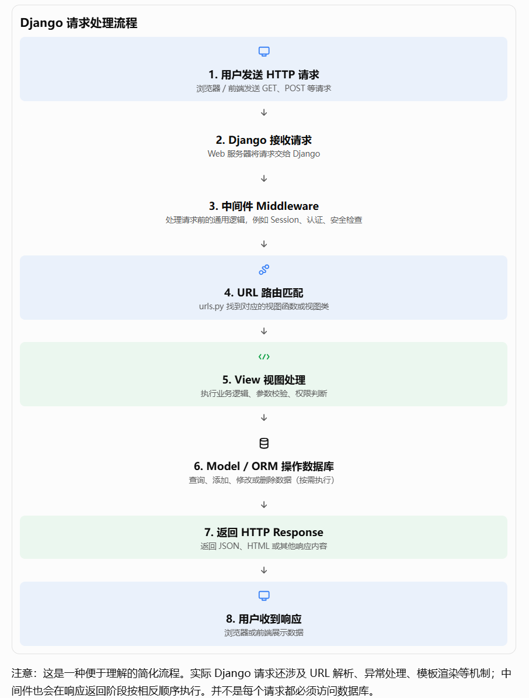
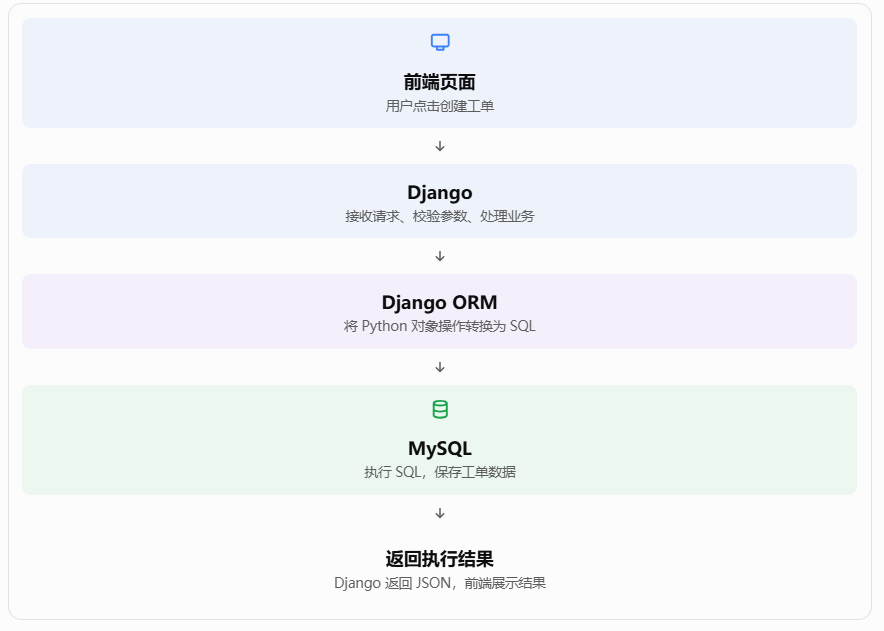
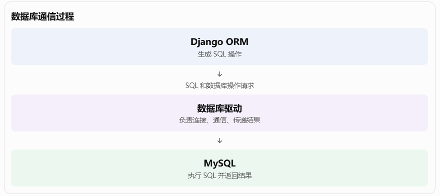
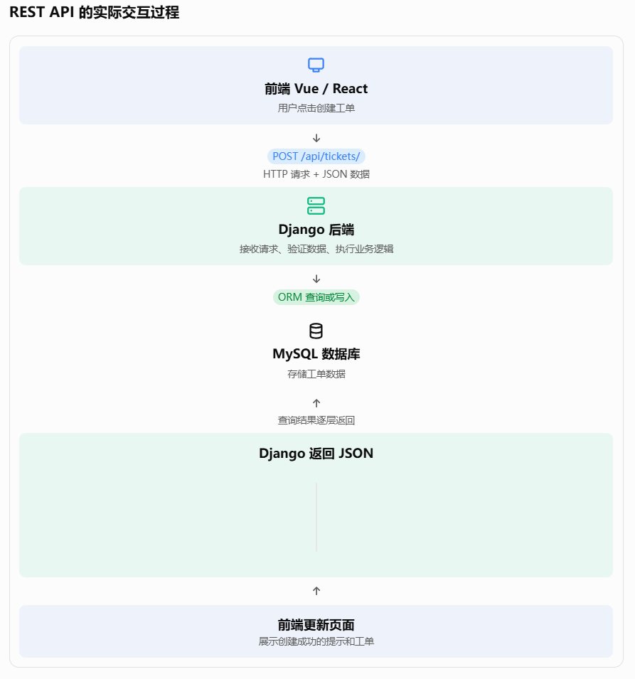
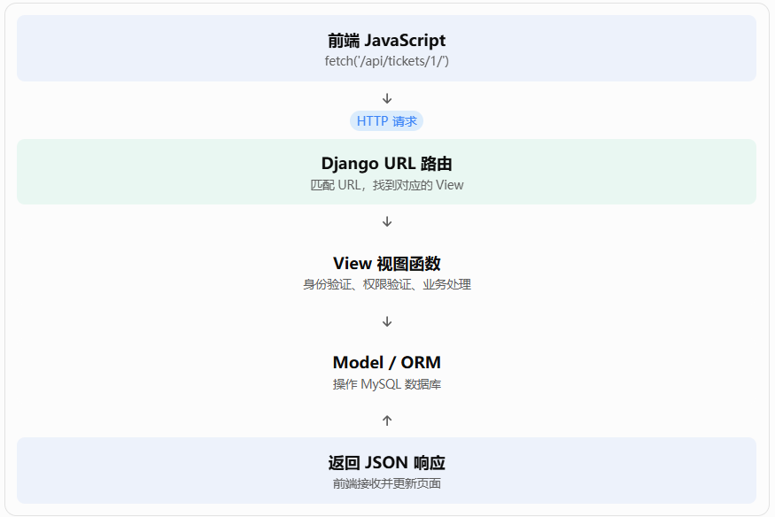
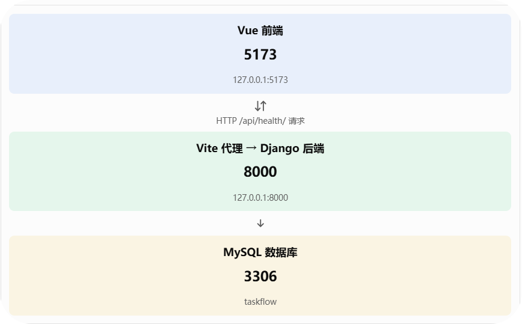

TaskFlow 项目正式启动：第一阶段——项目初始化与前后端联调

项目采用我们已经确定的技术方案：

- 前端： Vue 3 + Vite + Element Plus
- 后端： Python 3.11 + Django + Django REST Framework
- 数据库： MySQL 8.0
- 认证方案： JWT（第二阶段实现）
- 开发环境： Windows 11 + PyCharm / VS Code
- 版本管理： Git

第一阶段不急着实现所有业务功能。先完成一个可靠的项目骨架，确保前端、后端、数据库能够正常连接。之后再开发用户认证、角色权限和工单业务。

## 一、第一阶段的验收目标

完成后，项目应该达到以下状态：

1. Django 后端能够正常启动。
2. Vue 前端能够正常启动。
3. 前端能够请求 Django 后端接口。
4. Django 能够连接 MySQL。
5. 数据库中能够建立 TaskFlow 的核心业务表。
6. 项目目录清晰，方便后续扩展。
7. Git 能够管理前后端代码。

第一阶段先提供一个 `/api/health/` 健康检查接口，用它验证前后端联调是否成功。


## 二、项目整体目录结构

建议项目根目录命名为 `TaskFlow`。

```
TaskFlow/
│
├── backend/                       # Django 后端
│   ├── config/                    # Django 项目配置
│   │   ├── __init__.py
│   │   ├── settings.py
│   │   ├── urls.py
│   │   ├── asgi.py
│   │   └── wsgi.py
│   │
│   ├── apps/                      # 业务应用
│   │   ├── __init__.py
│   │   ├── common/                # 公共功能
│   │   │   ├── __init__.py
│   │   │   ├── views.py
│   │   │   └── urls.py
│   │   │
│   │   ├── users/                 # 用户与角色
│   │   │   ├── __init__.py
│   │   │   └── models.py
│   │   │
│   │   ├── departments/           # 部门
│   │   │   ├── __init__.py
│   │   │   └── models.py
│   │   │
│   │   └── tickets/               # 工单
│   │       ├── __init__.py
│   │       └── models.py
│   │
│   ├── manage.py
│   ├── requirements.txt
│   └── .env.example
│
├── frontend/                      # Vue 前端
│   ├── public/
│   ├── src/
│   │   ├── api/
│   │   │   └── request.js
│   │   ├── assets/
│   │   ├── components/
│   │   ├── layouts/
│   │   ├── router/
│   │   │   └── index.js
│   │   ├── views/
│   │   │   └── Dashboard.vue
│   │   ├── App.vue
│   │   └── main.js
│   │
│   ├── index.html
│   ├── package.json
│   └── vite.config.js
│
├── docs/                          # 项目文档
│   ├── database_design.md
│   └── api_design.md
│
├── .gitignore
└── README.md
```

注意：`apps` 是我们自己创建的 Python 包，后续用户、权限、工单、通知等功能都放在这里。不要把所有业务代码都写进 `views.py`。

## 三、数据库设计

第一版采用 MySQL，数据库名称为 `taskflow`，字符集使用 `utf8mb4`。

先设计核心业务表。后续随着功能开发，再逐步增加字段和索引。

### 3.1 核心数据表

| 数据表             | 用途         | 关键字段                                 |
| ------------------ | ------------ | ---------------------------------------- |
| users              | 用户         | id、username、email、password            |
| roles              | 角色         | id、name、code                           |
| user_roles         | 用户角色关系 | user_id、role_id                         |
| departments        | 部门         | id、name、description                    |
| tickets            | 工单         | id、title、description、status、priority |
| ticket_categories  | 工单分类     | id、name                                 |
| ticket_comments    | 工单评论     | id、ticket_id、user_id、content          |
| ticket_attachments | 工单附件     | id、ticket_id、file                      |
| tasks              | 任务         | id、title、assignee_id、status、deadline |
| notifications      | 通知         | id、user_id、content、is_read            |
| operation_logs     | 操作日志     | id、user_id、action、created_at          |

### 3.2 表之间的关系

```
departments
    |
    | 1:N
    v
users
    |
    | N:M
    v
roles

users --------------------+
    |                     |
    | 1:N                 | 1:N
    v                     v
tickets              ticket_comments
    |
    | 1:N
    v
ticket_attachments

users
    |
    | 1:N
    v
tasks

users
    |
    | 1:N
    v
notifications
```

几个重要设计决定：

- 一个部门可以有多个用户。
- 一个用户可以拥有多个角色。
- 一个工单有创建人和处理人，二者都关联用户表。
- 一个工单可以有多条评论和多个附件。
- 一个用户可以负责多个任务。
- 工单状态不能随意修改，后续会通过业务逻辑控制状态流转。

### 3.3 工单状态设计

| 状态       | 含义   |
| ---------- | ------ |
| pending    | 待处理 |
| processing | 处理中 |
| resolved   | 已解决 |
| closed     | 已关闭 |

优先级：

| 值     | 含义 |
| ------ | ---- |
| low    | 低   |
| medium | 普通 |
| high   | 高   |
| urgent | 紧急 |

这些状态先作为项目约定，后续会在后端编写状态流转规则，避免用户随意跳转状态。


## 四、开发环境配置

建议先准备以下软件：

| 软件              | 建议版本 | 用途     |
| ----------------- | -------- | -------- |
| Python            | 3.11.x   | 后端     |
| Node.js           | 22 LTS   | 前端     |
| MySQL             | 8.0      | 数据库   |
| Git               | 稳定版本 | 版本管理 |
| PyCharm / VS Code | 稳定版本 | 开发工具 |

先创建项目目录：

```
mkdir F:\Demo\TaskFlow
cd F:\Demo\TaskFlow

mkdir backend
mkdir frontend
mkdir docs
```

### 4.1 创建 Python 虚拟环境

```
cd backend

python -m venv .venv

.\.venv\Scripts\Activate.ps1

python -m pip install --upgrade pip
```

创建 `requirements.txt`：

```
Django==5.2.8
djangorestframework==3.16.1
django-cors-headers==4.9.0
PyMySQL==1.1.2
python-dotenv==1.2.1
djangorestframework-simplejwt==5.5.1
```

安装：

```
pip install -r requirements.txt
```

这里先安装 JWT 依赖，但第一阶段暂时不实现登录认证，第二阶段再使用。

### 4.2 创建 MySQL 数据库

打开 MySQL 客户端，执行：

```
CREATE DATABASE taskflow
CHARACTER SET utf8mb4
COLLATE utf8mb4_unicode_ci;
```

检查数据库：

```
SHOW DATABASES;
```

建议单独创建一个项目数据库账号，而不是长期使用 root：

```
CREATE USER 'taskflow_user'@'localhost'
IDENTIFIED BY 'TaskFlow_Dev_2026!';

GRANT ALL PRIVILEGES ON taskflow.*
TO 'taskflow_user'@'localhost';

FLUSH PRIVILEGES;
```

这里的密码仅作为本地开发示例，正式使用时应换成自己的强密码。


# 需要理解的知识点

# 一、第一阶段知识点总览

## TaskFlow 第一阶段学习路线

1. Python 虚拟环境与依赖管理

   理解 Python 环境、pip、requirements.txt。

2. Django 项目结构

   理解项目、应用、settings.py、urls.py、manage.py。

3. Django 配置管理

   理解 settings.py、环境变量、.env。

4. MySQL 数据库连接

   理解数据库、用户权限、数据库驱动、ORM。

5. Django ORM 与数据迁移

   理解 Model、makemigrations、migrate。

6. REST API 基础

   理解 HTTP 请求、响应、JSON、状态码。

7. Vue 3 前端基础

   理解 Vue、组件、生命周期、Axios。

8. 前后端分离与跨域

   理解 API 请求过程、Vite 代理、CORS。

9. Git 基础

   理解代码版本管理、提交和忽略文件。

# 二、需要掌握的具体知识

## 1. Python 虚拟环境与依赖管理       ```必须掌握```

首先理解为什么 Django 项目需要独立的 Python 环境。

**隔离项目依赖，避免版本冲突，提高项目的可维护性和可移植性。**

**核心知识点**：

- Python 虚拟环境是什么？

  ```
  在一个项目文件夹中创建一个相对独立的 Python 运行环境。
  注意：虚拟环境并不是一台新的虚拟机，它主要提供独立的 Python 解释器入口和依赖安装位置。
  ```

- 为什么不同项目需要不同的依赖版本？

  ```
  不同项目的开发时间、技术要求、代码兼容性以及第三方库之间的依赖关系可能不同。
  ```

- `venv` 的作用。

  ```
  为了给不同 Python 项目创建独立的运行环境，隔离不同项目之间的依赖，避免 Django 等第三方库出现版本冲突，同时方便项目迁移和部署。
  ```

- `pip` 的作用。

  ```
  `pip` 是 Python 的包管理工具。
  
  它主要负责安装、卸载、升级和查看 Python 第三方依赖。
  
  激活虚拟环境后，`pip` 默认会使用当前虚拟环境中的 pip，而不是全局环境中的 pip。
  ```

- `requirements.txt` 的作用。

  ```
  批量需安装依赖。
  注意：固定依赖版本可以保证不同开发者、不同机器上的项目环境尽可能一致，避免由于第三方库升级导致 API 变化、兼容性问题以及项目运行异常。
  ```

- 如何激活和退出虚拟环境。

  ```
  创建虚拟环境：python -m venv .venv
  
  激活虚拟环境：.\.venv\Scripts\Activate.ps1
  
  退出：deactivate
  ```

结合项目中的命令：

```
# 创建虚拟环境
python -m venv .venv

# 激活虚拟环境
.\.venv\Scripts\Activate.ps1

# 安装项目依赖
pip install -r requirements.txt

# 查看已安装依赖
pip list

# 退出虚拟环境
deactivate
```

你必须能够回答：

1. 为什么要创建 `.venv`？

   ```
   为了给不同 Python 项目创建独立的运行环境，隔离不同项目之间的依赖，避免 Django 等第三方库出现版本冲突，同时方便项目迁移和部署。
   ```

2. `pip install` 和 `pip install -r requirements.txt` 有什么区别？ 

   ```
   `pip install` 通常用于安装指定的单个 Python 第三方库，而 `pip install -r requirements.txt` 用于读取依赖文件，批量安装项目所需的依赖。
   ```

3. 为什么项目需要固定依赖版本？

   ```
   固定依赖版本可以保证不同开发者、不同机器上的项目环境尽可能一致，避免由于第三方库升级导致 API 变化、兼容性问题以及项目运行异常。
   ```

4. 如果没有激活虚拟环境，可能出现什么问题？

   ```
   如果没有激活虚拟环境，直接执行 Python 或 pip 命令，可能使用系统全局 Python 环境，导致依赖安装到错误的位置，出现模块找不到、版本不一致等问题。
   
   补充：如果使用虚拟环境中的 Python 完整路径，即使没有激活，也可以使用该环境；激活只是让命令行默认指向它。
   ```

   

## 2. Django 项目结构          ```必须掌握```

Django 是整个项目的后端基础。

先理解下面这些文件的作用：

| 文件          | 作用                |
| ------------- | ------------------- |
| `manage.py`   | Django 项目管理入口 |
| `settings.py` | 项目配置            |
| `urls.py`     | 路由配置            |
| `views.py`    | 处理请求和返回响应  |
| `models.py`   | 定义数据库模型      |
| `apps.py`     | Django 应用配置     |
| `admin.py`    | 后台管理配置        |

重点理解两个概念：

- Django Project：整个 Django 项目，负责全局配置和组织应用。
- Django App：具体功能模块，例如 users、departments、tickets。

TaskFlow 的结构：

```
backend/
├── config/                 # Django 项目配置
│   ├── settings.py
│   ├── urls.py
│   └── wsgi.py
│
├── apps/
│   ├── common/             # 公共模块
│   ├── users/              # 用户模块
│   ├── departments/        # 部门模块
│   └── tickets/            # 工单模块
│
└── manage.py
```

你必须能够回答：

1. Django 项目和 Django App 有什么区别？

   ```
   Django Project（项目）：整个网站或系统，负责统一管理配置、路由、数据库等。
   
   Django App（应用）：项目中的一个功能模块，负责实现某一类具体业务。
   ```

2. `INSTALLED_APPS` 有什么作用？

   ```
   INSTALLED_APPS` 是 Django 配置文件 `settings.py` 中的一个重要配置项。
   
   作用是：告诉 Django 当前项目需要加载和管理哪些应用。 
   
   可能出现的问题包括：
   - 模型没有被正常发现。
   - 执行数据库迁移时无法识别对应模型。
   - App 的相关配置和功能没有被加载。
   ```

3. `urls.py` 的作用是什么？

   ```
   `urls.py` 是 Django 的路由配置文件。
   
   它的核心作用是：将用户访问的 URL 地址映射到对应的视图函数或视图类。
   ```

4. 用户访问一个 Django 接口后，程序大致经过哪些步骤？

   

## 3. Django 配置管理与 .env    `必须掌握`

你刚刚操作的 `.env` 就属于这个知识点。

`.env` 用于保存环境配置，例如：

```
SECRET_KEY=your-secret-key
DEBUG=True

DB_NAME=taskflow
DB_USER=taskflow_user
DB_PASSWORD=your-password
DB_HOST=127.0.0.1
DB_PORT=3306
```

在 Django 中，通过环境变量读取配置：

```
import osSECRET_KEY = os.getenv("SECRET_KEY")DEBUG = os.getenv("DEBUG", "False") == "True"
```

必须理解：

- 什么是环境变量？

  ```
  环境变量（Environment Variables）是操作系统提供的一种配置数据存储方式。
  
  简单理解：环境变量就是提前存储在系统中的一些配置信息，程序运行时可以读取这些信息。
  ```

- `.env` 文件有什么作用？ 

  ```
  .env 是一种常见的环境配置文件，通常用于保存项目运行所需的配置。
  ```

- 为什么数据库密码不能直接写在 `settings.py`？

  ```
  敏感信息保护。
  
  假设你开发完成 TaskFlow，准备上传到 GitHub。
  
  如果你的 `settings.py` 中直接写了：
  
  ​```
  PASSWORD = 'example-password'
  ​```
  
  那么其他人只要能够查看你的 GitHub 仓库，就可能看到数据库密码。
  
  这会带来几个问题：
  
  1. 数据库可能被未经授权的人访问。
  2. 数据可能被恶意修改或删除。
  3. 数据库可能被利用进行其他攻击。
  4. 如果密码被多个服务复用，其他系统也可能受到影响。
  
  正确的做法是：
  
  将敏感信息放在 `.env` 文件中，再由 `settings.py` 读取。
  
  这样，代码中就不需要直接出现真实数据库密码。
  
  补充：.env 并不是绝对安全的保险箱，它只是将敏感配置从代码中分离。还需要限制文件访问权限，生产环境最好使用专门的密钥管理或环境配置服务。
  ```

- `.env.example` 和 `.env` 有什么区别？

  ```
  `.env`：本机实际使用的配置文件。
  
  `.env.example`：提供给其他开发者参考的配置模板。
  ```

- 为什么 `.env` 不应该提交到 GitHub？

  ```
  控制和敏感信息泄露。
  
  .gitignore 是 Git 的忽略配置文件。
  
  它可以指定哪些文件或目录不需要纳入 Git 的版本管理。
  ```

特别注意：`.env.example` 是配置模板，`.env` 才是你本机实际使用的配置文件。

## 4. MySQL 数据库基础      ```必须掌握```

TaskFlow 使用 MySQL 8.0。

你至少需要理解：

| 知识点        | 需要理解的内容   |
| ------------- | ---------------- |
| Database      | 数据库是什么     |
| Table         | 数据表是什么     |
| Field         | 字段是什么       |
| Primary Key   | 主键             |
| Foreign Key   | 外键             |
| Index         | 索引             |
| Character Set | 字符集           |
| Database User | 数据库账号和权限 |

结合 TaskFlow：

```
CREATE DATABASE taskflow
CHARACTER SET utf8mb4
COLLATE utf8mb4_unicode_ci;
```

这条 SQL 的作用是创建 TaskFlow 数据库，并设置支持完整 Unicode 字符的字符集。

还要理解数据库连接配置：

```
DATABASES = {    
	"default": {        
	"ENGINE": "django.db.backends.mysql",        
	"NAME": "taskflow",        
	"USER": "taskflow_user",        
	"PASSWORD": "数据库密码",        
	"HOST": "127.0.0.1",        
	"PORT": "3306",    
	}
}
```

你必须能够回答：

1. MySQL 和 Django 分别负责什么？

   ```
   Django 是 Python 的 Web 开发框架。
   
   它主要负责：
   
   - 接收用户请求。
   - 处理业务逻辑。
   - 用户登录和权限验证。
   - 调用 ORM 操作数据库。
   - 返回 HTML 或 JSON 数据。
   
   MySQL 是一种关系型数据库管理系统（RDBMS）。
   
   它主要负责：
   - 保存用户数据。
   - 保存部门信息。
   - 保存工单记录。
   - 保存任务信息。
   - 管理数据之间的关系。
   - 执行 SQL 查询、插入、更新和删除。
   ```

   

2. 数据库账号和数据库名称有什么区别？

   ```
   数据库账号：相当于进入服务器的身份凭证。
   
   数据库名称：相当于服务器中的一个具体文件柜。
   
   账号决定你是谁，以及你可以访问哪些数据库。
   
   数据库名称决定你具体要操作哪一个数据库。
   ```

3. 什么是数据库驱动？

   ```
   数据库驱动（Database Driver）可以理解为：
   
   应用程序和数据库之间负责通信的桥梁。
   ```

   

4. 为什么 Django 需要安装 PyMySQL？

   ```
   Django 的 MySQL 数据库后端需要一个能够实际通信的 Python 驱动。
   
   Django 常见的 MySQL 驱动是 `mysqlclient`
   
   让 PyMySQL 提供兼容 MySQLdb 的接口，使 Django 的 MySQL 后端能够使用它。
   
   注意：PyMySQL 并不是 Django 必须安装的唯一驱动。如果你使用 mysqlclient，通常不需要这段适配代码。
   ```

5. MySQL 的主键和外键分别有什么作用？

   ```
   主键（Primary Key，简称 PK）是用于唯一标识数据表中每一条记录的字段。
   
   外键（Foreign Key，简称 FK）用于建立不同数据表之间的关联关系。
   ```

## 5. Django ORM 与数据库迁移    ```必须掌握```

这是后端开发非常重要的知识点。

ORM 全称是 Object Relational Mapping，即对象关系映射。

简单理解：

通过 Python 类操作数据库，而不是每次都手写 SQL。

例如：

```
from django.db import modelsclass Department(models.Model):    
	name = models.CharField(max_length=100)    
	description = models.TextField(blank=True)    
	def __str__(self):        
		return self.name
```

Django 会根据这个模型生成对应的数据表结构。

重点理解三个命令：

```
# 根据模型变化生成迁移文件
python manage.py makemigrations

# 将迁移应用到数据库
python manage.py migrate

# 查看迁移执行状态
python manage.py showmigrations
```

二者区别：

| 命令             | 作用                         |
| ---------------- | ---------------------------- |
| `makemigrations` | 根据模型变化生成迁移文件     |
| `migrate`        | 执行迁移文件，修改数据库结构 |

特别注意：`makemigrations` 通常只是生成迁移文件，并不直接修改数据库；`migrate` 才会执行数据库结构变更。

你必须能够回答：

1. 什么是 ORM？

   ```
   ORM 是对象关系映射技术，可以将 Python 类和对象映射到关系型数据库中的表和记录。开发者可以使用 Python 代码操作数据库，减少手写 SQL 的工作量。
   
   ORM 的核心作用：将 Python 对象与数据库中的表记录建立映射关系。
   
   它的主要优点：
   1. 减少手写 SQL 的工作量。
   2. 提高代码可读性和开发效率。
   3. 方便管理数据库之间的关联关系。
   4. 在一定程度上降低对特定数据库的依赖。
   不过，ORM 并不意味着完全不需要 SQL。遇到复杂查询、性能优化等场景，仍然需要理解 SQL。
   ```

2. Django Model 和 MySQL 数据表有什么关系？

   ```
   Django 可以根据Model创建对应的 MySQL 数据表。
   
   Model 是 Python 代码中的类。
   
   数据表是 MySQL 中真实存储数据的结构。
   
   Model 定义字段、字段类型和约束。
   
   MySQL 数据表按照迁移结果创建对应的列和约束。
   ```

3. 为什么修改 Model 后需要迁移？

   ```
   如：
   业务需求发生变化，需要增加一个工单优先级字段
   
   Python 代码和数据库表结构不一致。
   
   因此，需要通过迁移同步两者。
   
   makemigrations 负责生成变更方案，migrate 负责真正执行变更。
   ```

4. migrations 文件夹有什么作用？

   ```
   用于保存数据库结构变化的历史迁移文件，记录创建表、增加字段、删除字段和修改字段等操作，方便数据库版本管理和团队协作。
   ```

5. 删除一个字段后，数据库会发生什么变化？

   ```
   删除 Model 字段后，执行 makemigrations 会生成删除字段的迁移操作，执行 migrate 后，数据库对应的列通常也会被删除，该列中的数据也会丢失。
   
   因此：
   
   1. 删除字段前，确认业务上不再需要它。
   2. 如果字段中有重要数据，提前备份或迁移数据。
   3. 不要随意删除已经执行过的迁移文件。
   4. 生产环境执行删除字段操作前，应先评估影响。
   
   另外，删除字段后，如果其他代码仍然使用 `ticket.priority`，就可能出现属性不存在或相关查询报错。
   ```

## 6. REST API 与 HTTP 基础     ```必须掌握```

这是前后端分离的核心。

TaskFlow 中，Vue 前端不会直接操作 MySQL，而是向 Django 后端发送 HTTP 请求。

例如：

```
GET /api/health/
```

Django 返回：

```
{
    "code": 200,
    "message": "TaskFlow backend is running"
}
```

需要理解的 HTTP 方法：

| 方法   | 作用     | 后续业务示例 |
| ------ | -------- | ------------ |
| GET    | 查询     | 查询工单     |
| POST   | 创建     | 创建工单     |
| PUT    | 整体更新 | 更新工单     |
| PATCH  | 局部更新 | 修改工单状态 |
| DELETE | 删除     | 删除工单     |

常见状态码：

| 状态码 | 含义           |
| ------ | -------------- |
| 200    | 请求成功       |
| 201    | 创建成功       |
| 400    | 请求参数错误   |
| 401    | 未认证         |
| 403    | 没有权限       |
| 404    | 资源不存在     |
| 500    | 服务器内部错误 |

你必须能够回答：

1. 什么是 REST API？

   ```
   先拆开理解这两个概念：
   
   - API（Application Programming Interface）：应用程序编程接口，可以理解为不同程序之间进行交互的入口。
   - REST（Representational State Transfer）：一种设计 Web API 的架构风格，强调使用 HTTP 方法和资源 URL 来表达操作。
   
   简单来说：
   
   REST API 就是按照 REST 风格设计的 HTTP 接口，让前端和后端通过统一的请求规则进行数据交互。
   ```

   

2. GET 和 POST 有什么区别？

   ```
   ## GET：获取数据
   GET 主要用于从服务器获取资源，通常不应该改变服务器的数据状态。
   
   ## POST：提交数据
   POST 通常用于向服务器提交数据，例如创建工单、提交注册信息、上传文件等。
   ```

   ## GET 和 POST 的核心区别

   | 对比项目   | GET                | POST                     |
   | ---------- | ------------------ | ------------------------ |
   | 主要用途   | 获取数据           | 提交数据                 |
   | 参数位置   | 通常在 URL 中      | 通常在请求体中           |
   | 数据可见性 | 参数可能显示在 URL | 请求体不会直接显示在 URL |
   | 浏览器缓存 | 通常可以缓存       | 默认通常不缓存           |
   | 幂等性     | 通常具有幂等性     | 不保证幂等性             |
   | 常见场景   | 查询工单、搜索     | 创建工单、提交表单       |

   ```
   这里需要特别理解两个概念：
   
   - 幂等性：同一个请求执行一次和执行多次，最终产生的服务器状态相同。
   - 安全性（HTTP 语义）：请求不应该要求服务器修改资源状态。
   
   GET 通常既是安全的，也是幂等的；POST 通常既不是安全的，也不保证幂等。
   
   另外，POST 并不天然比 GET 安全。两者都应该通过 HTTPS 保护传输内容。
   ```

3. JSON 是什么？

   ```
   JSON 全称是 JavaScript Object Notation，中文叫 JavaScript 对象表示法。
   
   它是一种轻量级的数据交换格式，主要用于前端和后端之间传递数据。
   
   这个数据具有几个特点：
   1. 使用键值对组织数据。
   2. 使用 {} 表示对象。
   3. 使用 [] 表示数组。
   4. 字符串使用双引号。
   5. 可以表示字符串、数字、布尔值、数组、对象和 null。
   
   JsonResponse 可以帮助我们将 Python 数据转换为 JSON 格式的 HTTP 响应。
   ```

4. HTTP 状态码有什么作用？

   ```
   HTTP 状态码是服务器返回给客户端的数字，用来表示这次 HTTP 请求的处理结果。
   ```

5. 前端为什么不能直接访问后端 Python 函数？

   ```
   1. 前端和后端运行环境不同
   
      前端代码通常运行在用户的浏览器中。
   
      例如：
   
      - Chrome
      - Edge
      - Safari
   
      后端 Python 代码运行在服务器端，由 Python 解释器执行。
   
      例如：
   
      - Django
      - FastAPI
      - Flask
   
      浏览器通常不具备直接运行 Django Python 函数的环境。
   
      
   
      前端代码通常运行在用户的浏览器中。
   
      例如：
   
      - Chrome
      - Edge
      - Safari
   
      后端 Python 代码运行在服务器端，由 Python 解释器执行。
   
      例如：
   
      - Django
      - FastAPI
      - Flask
   
      浏览器通常不具备直接运行 Django Python 函数的环境。
   
   2. 前后端之间通过 HTTP 协议通信
   
      虽然前端和后端使用不同的编程语言，但它们可以通过 HTTP 协议进行通信。
      
   3. 后端需要保护业务逻辑和数据库
   
   前端可以直接访问后端 Python 函数，那么就可能绕过：
   - 用户身份验证。
   - 用户权限检查。
   - 参数合法性验证。
   - 业务规则检查。
   所以，后端应该通过 HTTP 接口暴露经过控制的功能，而不是直接开放 Python 函数。
   
   补充：前端也可以通过 fetch() 调用同一台服务器上的接口，也可以调用其他服务器上的接口。如果跨域访问，还需要考虑 CORS 配置。
   ```

   

   

## 7. Vue 3 前端基础     ```必须掌握基础```

第一阶段不要求你成为前端开发人员，但必须理解前端如何调用后端接口。

需要掌握：

- Vue 3 是什么？

  ```
  Vue 3 是一个用于构建用户界面的 JavaScript 渐进式前端框架。
  
  简单来说，Vue 3 可以帮助我们使用 JavaScript 开发网页，而不需要完全依靠原生 HTML、CSS 和 JavaScript 手动管理页面。
  ```

- Vite 是什么？

  ```
  Vite 是一个现代前端开发工具，主要用于启动开发服务器、提供开发时的模块处理能力，以及构建生产环境代码。
  
  可以把它理解成 Vue 项目的开发助手。
  
  Vite 主要负责：
  1. 启动本地开发服务器。
  2. 支持修改代码后的快速更新。
  3. 处理前端模块和资源。
  4. 将项目构建成可部署的静态资源。
  ```

- Element Plus 是什么？

  ```
  Element Plus 是一个基于 Vue 3 的 UI 组件库。
  
  简单来说，它提供了很多已经开发好的页面组件，我们可以直接使用，而不必从零开始编写所有按钮、表格、弹窗和表单。
  ```

- Vue 组件是什么？

  ```
  组件就是一个可以重复使用、具有独立功能的页面模块。
  
  这样做有什么好处？
  1. 代码结构更加清晰。
  2. 同一个组件可以在多个页面重复使用。
  3. 修改某个组件时，不需要修改整个项目。
  4. 方便多人协作开发。
  ```

- ref()  的基本作用。

  ```
  ref()` 是 Vue 3 提供的一个响应式 API，主要用于创建响应式数据。
  
  1. 为什么需要 `ref()`？
  因为 Vue 需要追踪数据变化。当响应式数据发生变化时，Vue 会自动更新依赖它的页面内容。
  
  2. 为什么 JavaScript 中使用 `count.value`？
  因为 `ref()` 返回的是一个 Ref 对象，真正的数据存储在 `.value` 中。
  ```

- `onMounted()` 的基本作用。

  ```
  `onMounted()` 是 Vue 3 中的生命周期钩子。
  
  它的作用是：
  
  当 Vue 组件完成挂载，也就是组件已经创建并插入页面后，执行指定的代码。
  ```

  onMounted() 常见使用场景

  | 使用场景         | 示例                 |
  | ---------------- | -------------------- |
  | 页面初始化       | 初始化页面数据       |
  | 获取后端数据     | 请求工单列表 API     |
  | 初始化图表       | 创建数据可视化图表   |
  | 初始化第三方插件 | 地图、富文本编辑器等 |

- Axios 是什么？

  ```
  Axios 是一个基于 Promise 的 HTTP 客户端库，主要用于浏览器和 Node.js 环境中发送 HTTP 请求。
  
  简单来说：
  Axios 就是前端用来向 Django 后端发送 HTTP 请求的工具。
  ```

- `npm install` 和 `npm run dev` 的作用。

  ```
  这两个命令是前端开发中最常见的命令。
  
  首先需要理解 npm。
  
  npm 是 Node.js 生态中常用的包管理工具，主要负责安装、管理和运行 JavaScript 项目依赖。
  
  1. npm install
  
  作用：安装项目所需要的依赖包。
  
  2. npm run dev
  
  作用：执行 `package.json` 中定义的 `dev` 脚本，通常用于启动前端开发服务器。
  ```

  ## 两个命令的区别

  | 命令              | 作用             | 使用场景                 |
  | ----------------- | ---------------- | ------------------------ |
  | `npm install`     | 安装依赖         | 初次运行项目或依赖变化后 |
  | `npm run dev`     | 启动开发服务器   | 日常开发                 |
  | `npm run build`   | 构建生产版本     | 项目准备部署             |
  | `npm run preview` | 本地预览构建结果 | 检查生产构建             |

  ```
  可以简单记忆：
  
  - `npm install`：准备项目运行所需要的工具。
  - `npm run dev`：启动项目，开始开发。
  ```

  

例如：

```
import { ref, onMounted } from 'vue'
import axios from 'axios'

const message = ref('正在连接后端...')

onMounted(async () => {
  const response = await axios.get('/api/health/')
  message.value = response.data.message
})
```

理解这段代码：

1. `ref()` 创建响应式数据。
2. `onMounted()` 在组件挂载后执行。
3. `axios.get()` 向 Django 发送 GET 请求。
4. `response.data` 获取后端返回的数据。
5. `message.value` 修改数据后，Vue 自动更新页面。

你必须能够回答：

1. Vue 3 的作用是什么？

   ```
   负责前端页面。
   ```

2. Vite 的作用是什么？

   ```
   负责前端开发和构建。
   ```

3. Axios 是什么？

   ```
   负责前后端通信。
   ```

4. 前端如何获取 Django 返回的 JSON？

   ```
   前端通常使用 Axios 或 Fetch 发送 HTTP 请求，Django 后端通过视图函数处理请求，并使用 JsonResponse 返回 JSON 数据。前端收到响应后，通过 Axios 的 `response.data` 获取解析后的数据，再赋值给 Vue 的响应式变量，从而展示在页面上。
   ```

5. 为什么修改响应式数据后页面会自动更新？

   ```
   因为 Vue 3 有自己的响应式系统。组件渲染时，Vue 会追踪页面依赖的响应式数据。当数据发生变化时，Vue 会触发相关更新任务，重新执行组件渲染，并更新对应的 DOM，所以不需要手动操作页面。
   ```

## 8. 前后端分离、CORS 与 Vite 代理     ```必须掌握```

这是第一阶段最容易出现问题的地方。

TaskFlow 开发环境：



你需要理解：

- 前后端分离是什么意思？

  ```
  前后端分离，就是把一个 Web 项目拆分成两个相对独立的部分：
  
  - 前端： 负责页面展示、用户交互和数据呈现。
  - 后端： 负责业务逻辑、数据库操作、身份认证和接口数据处理。
  
  前后端分离不代表前后端不能部署在同一台服务器，而是指它们在开发和架构上职责相对独立，通过 API 接口通信。
  ```

- 为什么前端和后端使用不同端口？

  ```
  原因是前端和后端分别运行着独立的开发服务器。
  
  - Vite 负责 Vue 页面开发和热更新。
  - Django 负责处理 HTTP 请求和业务逻辑。
  
  端口可以理解为一台计算机上不同网络服务的入口。
  
  同一台电脑可以同时运行多个服务，只要它们监听的端口不冲突即可。
  
  注意：端口不同，本身就可能构成跨域。
  ```

- 什么是跨域？

  ```
  跨域（Cross-Origin），指浏览器中的页面向另一个不同源的地址发送请求。
  
  浏览器判断是否跨域，主要看三个部分：
  
  1. 协议：`http` 或 `https`
  2. 域名：`localhost`、`127.0.0.1` 等
  3. 端口：`5173`、`8000` 等
  
  这三个部分只要有一个不同，就属于不同源。
  
  为什么浏览器要限制跨域？
  这是浏览器的同源策略（Same-Origin Policy）。
  
  它主要是为了保护用户的数据安全，避免恶意网站随意读取其他网站的数据。
  ```

- 什么是 CORS？

  ```
  CORS，全称 Cross-Origin Resource Sharing，中文叫跨域资源共享。
  
  它是一种允许服务器明确授权其他来源访问资源的机制。
  
  简单来说：
  
  - 同源策略是浏览器的安全限制。
  - CORS 是服务器告诉浏览器：哪些来源可以访问我的接口。
  ```

- Vite 代理有什么作用？

  ```
  Vite 代理是开发环境中解决跨域问题的一种常见方法。
  
  它的核心原理是：
  
  让前端先向 Vite 开发服务器发送请求，再由 Vite 将请求转发给 Django。
  ```

- 开发环境代理和生产环境部署有什么区别？

  ```
  Vite 代理主要解决开发阶段的问题，不能直接当作生产环境的跨域解决方案。
  ```

  两种环境对比

  | 对比项   | 开发环境           | 生产环境                   |
  | -------- | ------------------ | -------------------------- |
  | 前端     | Vite 开发服务器    | Nginx 等提供静态文件       |
  | 后端     | Django 开发服务器  | Django 生产部署服务        |
  | 代理     | Vite Proxy         | Nginx 反向代理等           |
  | 主要目的 | 方便开发调试       | 正式提供服务               |
  | 热更新   | 支持               | 通常不需要                 |
  | CORS     | 可用 Vite 代理规避 | 根据实际域名和部署方式配置 |

这里特别注意：

Vite 代理和 CORS 不是同一个东西。

Vite 代理可以让浏览器请求前端同源地址，再由开发服务器转发到 Django；CORS 是浏览器对跨源请求实施的安全机制。项目也配置了 CORS，但使用 Vite 代理时，开发环境请求通常不需要依赖跨域许可。

## 9. Git 基础       ```需要掌握基础```

Git 用于管理项目代码版本。

至少掌握：

```
# 初始化 Git 仓库
git init

# 查看文件状态
git status

# 添加文件
git add .

# 提交代码
git commit -m "初始化 TaskFlow 项目"

# 查看提交历史
git log
```

还要理解 `.gitignore`：

```
.venv/
.env
__pycache__/
node_modules/
```

这些文件或目录通常不应该提交到代码仓库。


# 三、第一阶段知识掌握程度

不需要每个知识点都达到相同深度。建议按下面的标准学习：

| 知识点           | 掌握要求                   |
| ---------------- | -------------------------- |
| Python 虚拟环境  | 能独立创建和管理           |
| Django 项目结构  | 能解释主要文件作用         |
| .env 配置        | 能独立配置数据库连接       |
| MySQL            | 能建库、建用户、理解主外键 |
| Django ORM       | 能编写简单 Model           |
| 数据迁移         | 能独立执行迁移命令         |
| REST API         | 能理解请求和响应           |
| Vue 3            | 能看懂基础组件和接口请求   |
| Axios            | 能独立调用后端接口         |
| CORS / Vite 代理 | 能解释请求转发过程         |
| Git              | 能完成基本提交             |