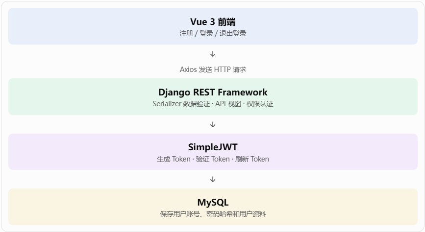
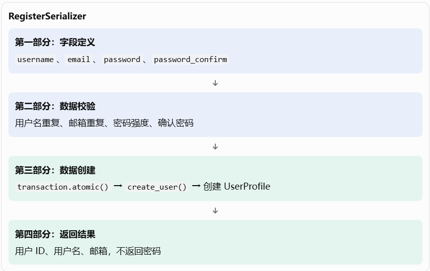
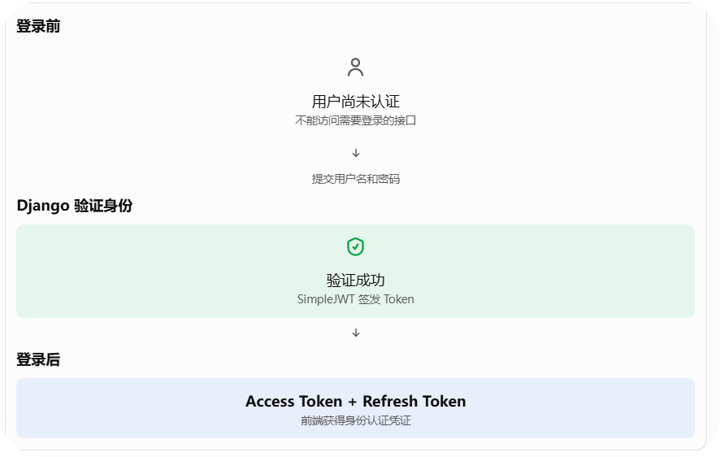
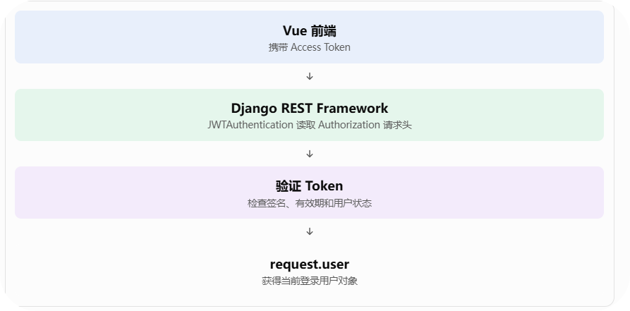

# 一、第二阶段开发目标

Phase 2：用户认证系统

开始开发

1. 用户注册

   用户提交用户名、邮箱、密码，后端验证数据并创建用户。

2. 用户登录

   用户提交账号和密码，后端验证身份。

3. JWT 身份认证

   登录成功后返回 Access Token 和 Refresh Token。

4. 获取当前用户信息

   携带 Access Token 请求接口，获取当前登录用户的信息。

5. Token 刷新

   Access Token 过期后，通过 Refresh Token 获取新的 Access Token。

6. 退出登录

   注销 Refresh Token，清除前端保存的登录凭证。

7. 前端登录状态管理

   实现登录页面、用户信息展示、路由访问限制。

# 二、先理解第二阶段的整体架构

整个认证流程如下：



你需要先理解几个核心概念：

| 概念           | 作用                   |
| -------------- | ---------------------- |
| Authentication | 身份认证：你是谁？     |
| Authorization  | 权限控制：你能做什么？ |
| JWT            | 用于身份认证的令牌机制 |
| Access Token   | 访问受保护接口         |
| Refresh Token  | 获取新的 Access Token  |
| Serializer     | 验证和转换 API 数据    |
| Permission     | 控制接口是否允许访问   |

特别注意：身份认证和权限控制不是同一回事。

第二阶段主要解决“你是谁”，第三阶段再重点解决“你能做什么”。

# 三、第二阶段的接口设计

我们先确定 API 结构，避免后续接口混乱。

| 接口                       | 请求方式 | 功能         | 是否需要登录 |
| -------------------------- | -------- | ------------ | ------------ |
| `/api/auth/register/`      | POST     | 用户注册     | 否           |
| `/api/auth/login/`         | POST     | 用户登录     | 否           |
| `/api/auth/token/refresh/` | POST     | 刷新 Token   | 否           |
| `/api/auth/me/`            | GET      | 获取当前用户 | 是           |
| `/api/auth/logout/`        | POST     | 退出登录     | 是           |

## 1. 用户注册

请求：

```
{
  "username": "testuser",
  "email": "test@example.com",
  "password": "Test123456",
  "password_confirm": "Test123456"
}
```

成功后返回：

```
{
  "code": 201,
  "message": "注册成功",
  "data": {
    "id": 1,
    "username": "testuser",
    "email": "test@example.com"
  }
}
```

密码必须经过 Django 密码哈希处理，不能明文保存，也不能在接口响应中返回密码。

## 2. 用户登录

请求：

```
{
  "username": "testuser",
  "password": "Test123456"
}
```

成功后返回：

```
{
  "access": "Access Token",
  "refresh": "Refresh Token"
}
```

## 3. 获取当前用户信息

请求头：

```
Authorization: Bearer <Access Token>
```

返回：

```
{
  "id": 1,
  "username": "testuser",
  "email": "test@example.com"
}
```

# 四、后端目录结构规划

在现有项目基础上，逐步完善用户认证模块：

```
backend/
├── config/
│   ├── settings.py
│   └── urls.py
│
├── apps/
│   ├── common/
│   ├── users/
│   │   ├── models.py
│   │   ├── serializers.py       # 新增
│   │   ├── views.py             # 新增
│   │   ├── urls.py              # 新增
│   │   └── tests.py             # 新增
│   ├── departments/
│   └── tickets/
│
└── manage.py
```

这里继续使用 Django 内置的 `auth.User`，通过现有的 `UserProfile` 扩展用户资料，不在这个阶段贸然更换用户模型。

# 五、具体开发顺序

| 步骤 | 开发任务                   | 验收结果                 |
| ---- | -------------------------- | ------------------------ |
| 2.1  | 检查现有用户模型和认证配置 | 确认模型及依赖可用       |
| 2.2  | 编写注册 Serializer 和 API | 能成功注册用户           |
| 2.3  | 配置 SimpleJWT 登录接口    | 能获取双 Token           |
| 2.4  | 实现当前用户信息接口       | 能验证 Token             |
| 2.5  | 实现刷新与退出登录         | Token 生命周期正常       |
| 2.6  | 编写后端认证测试           | 正常和异常场景均通过     |
| 2.7  | 开发 Vue 登录注册页面      | 前后端认证联通           |
| 2.8  | 实现前端登录状态和路由守卫 | 未登录不能访问受保护页面 |


## 2.1 理解用户认证系统

### 1. 用户认证

Authentication（身份认证）：确认用户身份，例如验证用户名和密码。

Authorization（权限控制）：判断用户是否有权执行某项操作，例如能否删除工单。

身份认证解决用户身份识别问题，权限控制解决用户资源访问和操作授权问题。

###  2.Django 为什么需要 User 模型？

Django 已经内置了一套用户管理系统。

### 3.为什么还要有 UserProfile？

虽然 Django 的 User 已经包含用户基础信息，但企业系统通常还需要更多业务字段。

通过 Profile 模型扩展用户资料，可以减少对 Django 内置 User 模型的修改，降低认证系统的维护成本。

### 4.DRF 和 SimpleJWT 分别负责什么？

这是第二阶段非常重要的技术组合。

| 技术      | 作用                              |
| --------- | --------------------------------- |
| Django    | 提供 Web 框架、ORM、用户模型      |
| DRF       | 帮助开发 REST API                 |
| SimpleJWT | 负责 JWT Token 的签发、验证和刷新 |
| MySQL     | 保存用户和业务数据                |
| Vue 3     | 构建前端页面                      |
| Pinia     | 管理前端登录状态                  |
| Axios     | 发送 HTTP 请求                    |


## 2.2  编写注册 Serializer 和 API  能成功注册用户

先实现用户注册，不要同时开发登录、JWT 和前端页面。

注册接口需要完成以下工作：

1. 接收用户名、邮箱、密码和确认密码。
2. 验证用户名是否重复。
3. 验证邮箱是否重复。
4. 验证两次密码是否一致。
5. 使用 Django 的 `create_user()` 创建用户。
6. 自动生成对应的 `UserProfile`。
7. 返回注册成功信息，但绝不返回密码。

预计涉及的文件：

```
backend/apps/users/
├── models.py
├── serializers.py     # 注册数据验证
├── views.py           # 注册接口
├── urls.py            # 注册路由
└── tests.py            # 注册测试
```

### 1. 什么是 Serializer？

Serializer 是 DRF 中非常重要的组件。

你可以先把它理解成一个数据检查员和数据转换器。

Serializer 可以检查：

- 用户名是否为空。
- 邮箱格式是否正确。
- 密码是否符合要求。
- 用户名是否已经存在。
- 邮箱是否已经注册。

如果数据不符合要求，就返回错误，而不是直接写入数据库。

### 2. 什么是 View？

View 是处理 HTTP 请求的地方。

它负责接收注册请求、调用 Serializer、处理注册业务，并返回 HTTP 响应。

### 3. 什么是 ORM？

ORM 全称 Object Relational Mapping，即对象关系映射。

它让我们可以使用 Python 操作数据库，而不必每次手写 SQL。

Django 会负责将操作转换为对应的数据库语句。

### 4.serializers

#### 4.1其中的 `RegisterSerializer` 负责：

1. 接收前端提交的注册数据。
2. 校验用户名和邮箱。
3. 检查密码强度。
4. 检查两次密码是否一致。
5. 创建 Django User。
6. 创建关联的 UserProfile。

目前我们已经确认，你的实际实现使用了以下设计：

| 技术                           | 在注册功能中的作用                 |
| ------------------------------ | ---------------------------------- |
| `serializers.Serializer`       | 定义注册数据及校验规则             |
| `iexact`                       | 忽略大小写检查用户名和邮箱是否重复 |
| `validate_password()`          | 执行 Django 密码强度校验           |
| `transaction.atomic()`         | 保证用户和资料创建的事务一致性     |
| `create_user()`                | 创建用户并对密码进行哈希           |
| `UserProfile.objects.create()` | 创建关联的用户扩展资料             |

#### 4.2理解 RegisterSerializer 的整体结构

可以先把它理解为一个注册数据处理中心：




### **需要学会**

开发完成后，你需要重点理解这几个知识点：

| 知识点                          | 为什么重要                |
| ------------------------------- | ------------------------- |
| DRF Serializer                  | API 参数验证与数据转换    |
| `create_user()`                 | Django 用户创建和密码哈希 |
| `set_password()`                | 安全设置用户密码          |
| `transaction.atomic()`          | 保证多表操作的一致性      |
| `UniqueConstraint` / 唯一性验证 | 避免重复用户              |
| API 测试                        | 验证注册接口是否可靠      |

尤其要理解：

```
User.objects.create_user(    
	username=username,    
	email=email,    
	password=password
)
```

它与普通的：

```
User.objects.create(    
	username=username,    
	password=password
)
```

有本质区别。前者会正确处理密码哈希，后者不会自动替你安全地处理密码。


### 有三个细节需要继续关注

1. 用户名和邮箱的唯一性

使用 `iexact` 可以在应用层检查大小写不敏感的重复情况。

但需要知道：应用层检查不能完全避免并发注册时的竞争条件。最终还应结合**数据库唯一约束**，确保**数据一致性**。邮箱字段也要根据现有模型设计决定是否需要独立唯一约束。

2. 密码验证

你使用了：

```
validate_password()
```

这意味着密码验证可以遵循 Django 的 `AUTH_PASSWORD_VALIDATORS` 配置。

建议后续确认 `settings.py` 中确实配置了合理的密码验证器。


## 2.3  配置 SimpleJWT 登录接口   能获取双 Token

### 2.3.1 先理解 JWT 是什么

JWT 全称：JSON Web Token。

它是一种用于在客户端和服务端之间传递身份信息的令牌格式。

在 TaskFlow 中，登录成功后，后端会向前端返回两种 Token：

| Token         | 有效期  | 主要用途           |
| ------------- | ------- | ------------------ |
| Access Token  | 30 分钟 | 访问需要登录的 API |
| Refresh Token | 7 天    | 获取新的 Token     |

### 2.3.2 理解 JWT 的组成结构

JWT 通常由三个部分组成：

### JWT 三部分结构

第一部分

Header：头部

描述令牌类型和签名算法，例如 HS256。

示意内容

```
{
  "typ": "JWT",
  "alg": "HS256"
}
```


第二部分

Payload：载荷

存放声明信息，例如用户 ID、Token 类型、过期时间。

示意内容

```
{
  "user_id": 12,
  "token_type": "access",
  "exp": 1790000000
}
```


第三部分

Signature：签名

用于验证令牌是否被篡改，以及签名是否可信。


**为什么需要签名？**

如果没有签名校验，服务端可能无法发现载荷被修改。

有了签名后，服务端验证时会发现签名不匹配，从而拒绝这个 Token。


### 登录前后有什么区别？



### 两种 Token 的区别

| 对比     | Access Token       | Refresh Token       |
| -------- | ------------------ | ------------------- |
| 作用     | 访问受保护接口     | 刷新 Access Token   |
| 有效期   | 较短               | 较长                |
| 使用频率 | 每次访问受保护接口 | Access Token 过期时 |
| 安全要求 | 不能泄露           | 更需要妥善保护      |

建议第一版配置：

- Access Token：30 分钟
- Refresh Token：7 天
- Refresh Token 黑名单：启用

有效期可以后续根据实际部署环境调整。


### **需要学会**

重点掌握以下五个问题：

1. JWT 是什么？为什么前后端分离项目经常使用 JWT？

   ```
   JSON Web Token, 它是一种用于在客户端和服务端之间传递身份信息的令牌格式。进行身份验证
   ```

2. Access Token 和 Refresh Token 有什么区别？

   | Token         | 有效期  | 主要用途           |
   | ------------- | ------- | ------------------ |
   | Access Token  | 30 分钟 | 访问需要登录的 API |
   | Refresh Token | 7 天    | 获取新的 Token     |

3. Django 的 `authenticate()` 是如何验证用户名和密码的？

   ```
   `authenticate()` 本身不读取请求体，也不创建登录 Session。它只是依次调用 `AUTHENTICATION_BACKENDS` 中配置的后端，返回第一个验证成功的用户对象。
   ```

4. DRF 的 `JWTAuthentication` 如何从请求头中获取 Token？

   ```
   `JWTAuthentication.authenticate()` 的流程是：
   
   1. 通过 DRF 的 `get_authorization_header(request)` 读取 `HTTP_AUTHORIZATION`。
   2. 将请求头拆分成认证类型和原始 Token。
   3. 检查认证类型是否在 `AUTH_HEADER_TYPES` 中，默认是 `Bearer`。
   4. 将原始 Token 构造成 Access Token 对象。
   5. 校验签名、过期时间及其他 Token 声明。
   6. 从 `user_id` 声明中取得用户 ID。
   7. 查询用户并检查 `is_active`。
   8. 返回 `(user, validated_token)`，DRF 将其分别放入：
   ```

5. 为什么 Token 过期后需要刷新，而不是要求用户重新登录？

   ```
   这是安全性和用户体验之间的折中。
   
   Access Token 经常在每次 API 请求中发送，暴露机会更多；同时 JWT 是自包含的，服务端通常无法像删除 Session 一样立即让某个 Access Token 失效。因此通常把它的有效期设置得比较短，例如 5～30 分钟。
   
   Refresh Token 只在刷新接口中使用，暴露频率低，可以设置更长有效期。Access Token 过期后,服务端验证 Refresh Token，然后返回新的 Access Token
   ```

```
这样做的主要原因是：

- 减少重复输入账号密码，改善用户体验。
- 缩短被盗 Access Token 的有效时间。
- 不必在网络中反复传输用户密码。
- 可以配合 Refresh Token 轮换、黑名单和撤销机制。
- 可以在 Refresh Token 中保存比 Access Token 更少被频繁使用的长期凭据。

但刷新不是无限续期。以下情况仍然需要重新登录：
- Refresh Token 已过期。
- Refresh Token 被撤销或加入黑名单。
- 用户修改密码、被禁用或主动退出登录。
- Refresh Token 本身无效或签名校验失败。
```

**从 Vue 提交用户名和密码，到 Django 返回两个 Token，中间经历了哪些步骤？**

前端通过 POST 请求提交用户名和密码，Django URL 路由将请求交给 LoginAPIView。View 从 request.data 获取请求数据，并创建 LoginSerializer 实例。随后调用 is_valid() 触发 SimpleJWT 的认证逻辑，通过 Django authenticate() 验证用户身份。认证成功后，SimpleJWT 签发 Access Token 和 Refresh Token，View 最后通过 Response 将两个 Token 返回给前端。


## 2.4  实现当前用户信息接口     能验证 Token

这一接口是 JWT 认证真正发挥作用的地方。

之前的登录接口解决了：

> 用户输入账号密码，如何获得 Token？

现在要解决：

> 用户拿着 Token 访问后端，Django 如何知道他是谁？

### 1. 接口设计

需要 JWT 认证

| 项目       | 内容            |
| ---------- | --------------- |
| 请求方式   | GET             |
| 接口地址   | `/api/auth/me/` |
| 请求认证   | Bearer Token    |
| 请求参数   | 无              |
| 成功状态码 | 200             |

请求头：

```
Authorization: Bearer <access-token>
```

成功响应建议：

```
{
  "code": 200,
  "message": "获取用户信息成功",
  "data": {
    "id": 1,
    "username": "testuser",
    "email": "test@example.com"
  }
}
```

如果没有携带 Token，应该返回 `401 Unauthorized`。

如果 Token 无效或已经过期，也应该拒绝请求。

### 2.请求认证过程



这里有一个重要知识点：

```
request.user
```

当 JWT 认证成功后，DRF 会把对应的 Django 用户对象放到 `request.user` 中。

因此，你不需要在每个接口中重新接收用户名和密码。

### 2.4.1 Authentication 与 Permission 的区别

| 对比     | Authentication    | Permission       |
| -------- | ----------------- | ---------------- |
| 中文     | 身份认证          | 权限判断         |
| 核心问题 | 你是谁？          | 你能做什么？     |
| 主要职责 | 识别当前用户      | 判断是否允许访问 |
| 典型对象 | JWTAuthentication | IsAuthenticated  |
| 执行逻辑 | 验证身份凭证      | 检查访问条件     |
| 失败结果 | 认证失败          | 权限拒绝         |

记住一句话：

Authentication 负责识别用户，Permission 负责决定用户能否访问资源。

### 2.4.2 DRF 的认证流程

### 需要学会

在 Codex 开发 2.4 时，重点理解：

| 知识点              | 需要理解的问题                     |
| ------------------- | ---------------------------------- |
| `request.user`      | 当前用户对象从哪里来？             |
| `JWTAuthentication` | 如何从请求头识别用户？             |
| `IsAuthenticated`   | 为什么未登录用户无法访问接口？     |
| `Authorization`     | Bearer Token 请求头是什么？        |
| 401 与 403          | 身份认证失败和权限不足有什么区别？ |

## 2.5  实现刷新与退出登录      Token 生命周期正常

建议继续实现：

```
POST /api/auth/token/refresh/
```

这一阶段重点理解三个问题：

1. Access Token 过期后，为什么不需要用户重新输入密码？
2. Refresh Token 如何换取新的 Access Token？
3. 开启 Token 轮换和黑名单后，旧 Refresh Token 为什么不能重复使用？


## 2.6  编写后端认证测试     正常和异常场景均通过（退出登录接口）

接口建议：

```
POST /api/auth/logout/
```

核心流程：

1. 前端提交当前持有的 Refresh Token。
2. 后端验证 Refresh Token。
3. 后端将其加入黑名单。
4. 返回退出登录成功。
5. 后续再次使用这个 Refresh Token 刷新时，返回 401。

还要明确一个边界：退出登录后，已经签发的 Access Token 通常不会立即失效，仍可能在剩余有效期内访问接口。当前项目 Access Token 有效期为 30 分钟。

#### 本阶段的一个重要设计问题： 

退出登录接口是否要求 Access Token 认证，需要结合刷新场景考虑。若 Access Token 已经过期，用户仍应能够使用有效 Refresh Token 完成退出。因此，可以考虑不强制 `IsAuthenticated`，但必须严格验证 Refresh Token，并且只能撤销请求中提交的那一个 Token。


## 2.7   开发 Vue 登录注册页面  前后端认证联通

接下来需要让 Vue 前端真正使用刚刚完成的后端认证接口，而不是只通过 PowerShell 测试。

建议按照以下顺序开发：

1. Axios 请求封装：统一 API 基础地址、请求头和响应处理。
2. Token 管理：统一保存、读取和清除 Access Token、Refresh Token。
3. 登录页面：调用 `/api/auth/login/`，登录成功后保存 Token。
4. 当前用户状态：调用 `/api/auth/me/`，获取用户信息。
5. 路由权限控制：未登录用户不能进入受保护页面。
6. 自动刷新机制：Access Token 过期时调用刷新接口，并处理并发请求。
7. 退出登录：调用 `/api/auth/logout/`，成功后清除本地认证信息。
8. 注册页面：接入已有注册接口。

开发时要特别注意：多个请求同时遇到 401 时，不能同时使用同一个旧 Refresh Token 发起刷新，否则 Token 轮换机制可能导致其中一些请求失败。需要设计请求排队或刷新锁。

### 2.7.1   Axios 请求封装

- 统一配置 Django 后端 API 地址。
- 创建 Axios 实例。
- 统一设置 JSON 请求头。
- 添加请求拦截器，为后续自动携带 Access Token 做准备。
- 添加响应拦截器，统一处理 HTTP 错误。
- 验证 Vue 能正常请求 Django 的 `/api/health/`。

### 2.7.2 Token 管理

用户登录成功后，Access Token 和 Refresh Token 应该保存在哪里，其他模块又如何统一读取？

建议采用独立模块管理，不允许登录页面、Axios 拦截器和其他组件各自操作 Token。

推荐目录：

```
frontend/src/
├── api/
│   ├── health.js
│   └── auth.js
├── utils/
│   ├── request.js
│   └── token.js
└── stores/
    └── auth.js
```

其中：

- `token.js`：负责 Token 的保存、读取、清除。
- `auth.js`：负责登录状态、当前用户信息等响应式状态。
- `request.js`：负责请求时自动携带 Access Token。

关于存储方式： 当前阶段可以使用 `sessionStorage`，关闭浏览器标签页后会话数据会被清除。它比 `localStorage` 更适合当前这个学习项目的初始实现，但两者都无法防止 XSS 脚本读取 Token。生产环境可以进一步考虑 HttpOnly、Secure、SameSite Cookie 等方案。

### 2.7.3 Pinia 认证状态管理

现在已经有：

- Axios：负责发送请求。
- Token 模块：负责保存和读取 Token。

还缺少一个统一管理用户登录状态的地方。

这就是 Pinia 的作用。

建议建立：

```
frontend/src/
├── api/
│   ├── health.js
│   └── auth.js
├── stores/
│   └── auth.js
└── utils/
    ├── request.js
    └── token.js
```

本阶段需要实现的状态：

| 状态              | 作用                 |
| ----------------- | -------------------- |
| `accessToken`     | 当前 Access Token    |
| `refreshToken`    | 当前 Refresh Token   |
| `user`            | 当前登录用户信息     |
| `isAuthenticated` | 是否处于登录状态     |
| `isLoading`       | 是否正在获取用户信息 |

需要实现的操作：

- `setAuth()`：保存 Token 和用户信息。
- `clearAuth()`：清除 Token 和用户信息。
- `fetchCurrentUser()`：调用 `/api/auth/me/` 获取用户资料。
- `initializeAuth()`：页面刷新后恢复认证状态并验证当前用户。

注意：本阶段不要实现自动刷新。Access Token 失效时，应明确处理认证失败，不要无限重试。

### 2.7.4 登录页面

建议采用 Element Plus，先做一个完整但不过度复杂的登录页面。

Login Page designs, themes, templates and downloadable graphic elements on Dribbble

https://dribbble.com/tags/login-page?utm_source=chatgpt.com)

页面需要包含：

- TaskFlow 项目名称和简短介绍。
- 用户名输入框。
- 密码输入框。
- 显示/隐藏密码。
- 登录按钮和加载状态。
- 表单验证。
- 登录失败提示。
- 登录成功后跳转到 Dashboard。

登录流程：

```
用户输入用户名和密码
        ↓
调用 POST /api/auth/login/
        ↓
获取 Access Token 和 Refresh Token
        ↓
调用 GET /api/auth/me/
        ↓
获取当前用户信息
        ↓
调用 Pinia setAuth()
        ↓
跳转 Dashboard
```

这里有一个重要细节：不要在登录成功后只保存 Token 就直接显示已登录。 应先获取当前用户信息，再通过 `setAuth()` 统一建立认证状态。

### 2.7.5 当前用户与路由权限

接下来需要解决一个重要问题：

用户登录后，如果刷新浏览器，为什么还能保持登录状态？如果没有登录，为什么不能直接访问 Dashboard？

这一阶段主要完成三个功能：

1. 页面刷新后恢复登录状态。
2. 访问受保护页面前检查用户身份。
3. 未登录用户自动跳转登录页面。

### 2.7.6 Token 自动刷新

### 2.7.7 可以开始规划以下两个功能：

用户注册：

- 注册页面。
- 用户名、邮箱、密码和确认密码。
- 前端表单验证。
- 调用 Django 注册接口。
- 注册成功后引导用户登录。

用户退出登录：

- 调用 Django 退出接口。
- 提交当前 Refresh Token。
- 后端将 Refresh Token 加入黑名单。
- 清除前端 Access Token、Refresh Token 和 Pinia 用户状态。
- 返回登录页面。
- 处理退出接口异常，避免本地登录状态残留。

特别注意：退出登录不能只清除浏览器 Token，还要调用后端黑名单接口。即使退出接口发生网络异常，也应该优先清除本地认证状态，并明确告知用户服务端撤销状态尚未确认。